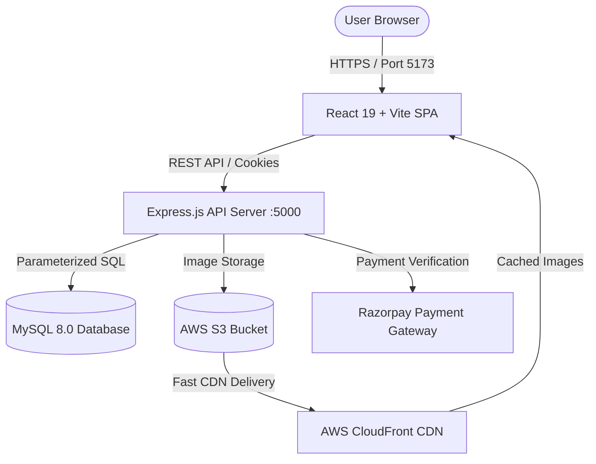
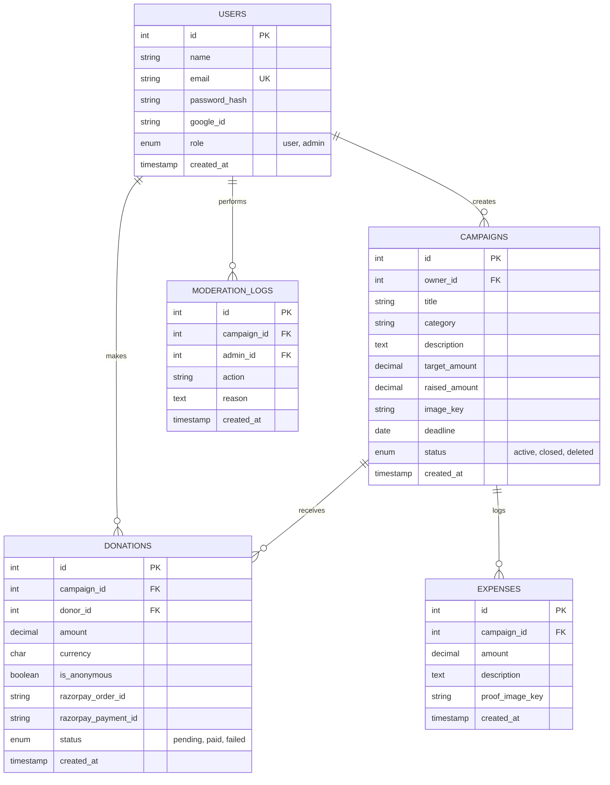

# Fundit — Professional Full-Stack Crowdfunding Platform

[](https://nodejs.org/)
[](https://react.dev/)
[](https://vitejs.dev/)
[](https://www.mysql.com/)
[](https://aws.amazon.com/)
[](LICENSE)
[](SETUP_GUIDE.md)
[](SETUP_GUIDE.md)

Fundit is a production-ready, security-focused crowdfunding web application where individuals and non-profits can create campaigns, raise verified funds, track expenses transparently, and accept donations via Razorpay.

Designed as a high-impact B.Tech capstone and portfolio project, Fundit follows modern full-stack engineering standards, strict security practices, and cloud-native AWS architecture.

---

## 📁 Repository Structure

The project is cleanly decoupled into two distinct folders:

```
FUNDIT/
├── backend/                       # Node.js + Express API server
│   ├── routes/                    # Modular Express route handlers
│   │   ├── authRoutes.js          # Authentication (Signup, Login, Google OAuth, Me, Logout)
│   │   ├── campaignRoutes.js      # Campaign CRUD, filtering, pagination, search
│   │   ├── donationRoutes.js      # Razorpay order creation, HMAC verification, history
│   │   ├── expenseRoutes.js       # Campaign expense reporting & proof uploads
│   │   └── adminRoutes.js         # Admin moderation & user management
│   ├── auth.js                    # JWT sign/verify, password hashing & cookie middleware
│   ├── categories.js              # Canonical campaign categories
│   ├── db.js                      # MySQL2 connection pool with parameterized query helper
│   ├── upload.js                  # Multer with S3/CloudFront & local disk fallback
│   ├── schema.sql                 # MySQL 8.0 DDL schema definitions
│   ├── seed.sql                   # Realistic demo dataset for local testing
│   ├── setup-db.bat               # Automated Windows MySQL setup script
│   ├── package.json               # Backend dependencies and scripts
│   └── .env.example               # Template environment configuration
│
├── frontend/                      # React 19 + Vite single page application (SPA)
│   ├── src/
│   │   ├── components/            # Reusable UI components
│   │   │   ├── Navbar.jsx         # Responsive navigation with auth state
│   │   │   ├── Footer.jsx         # Standardized site footer
│   │   │   ├── CampaignCard.jsx   # Card with progress bar & funding stats
│   │   │   └── ProtectedRoute.jsx # Client-side route guards (auth + admin roles)
│   │   ├── context/
│   │   │   └── AuthContext.jsx    # Global user session provider (HTTP-only cookie restored)
│   │   ├── pages/                 # Full application views
│   │   │   ├── HomePage.jsx       # Hero, featured campaigns, categories, trust stats
│   │   │   ├── ExplorePage.jsx    # Search, category filter, sorting, pagination
│   │   │   ├── CampaignDetailPage.jsx # Donation flow, expense reports, donor wall
│   │   │   ├── CreateCampaignPage.jsx # Multi-field campaign creation with image upload
│   │   │   ├── DashboardPage.jsx  # User campaigns & donation history
│   │   │   ├── AdminPage.jsx      # Moderation dashboard & user management
│   │   │   ├── LoginPage.jsx      # Email/Password + Google Login
│   │   │   ├── SignupPage.jsx     # Registration flow
│   │   │   ├── AboutPage.jsx      # Mission & operational transparency
│   │   │   ├── PrivacyPage.jsx    # Privacy policy
│   │   │   ├── TermsPage.jsx      # Terms of service
│   │   │   └── NotFoundPage.jsx   # Clean 404 handler
│   │   ├── api.js                 # Unified fetch API client with credentials
│   │   ├── categories.js          # Synchronized category icons & labels
│   │   ├── utils.js               # INR currency formatting, dates, percentages
│   │   ├── index.css              # Custom design system (variables, cards, typography)
│   │   ├── App.jsx                # React Router v7 configuration
│   │   └── main.jsx               # React DOM entry point
│   ├── package.json               # Frontend dependencies and build scripts
│   └── vite.config.js             # Vite dev server with /api and /uploads proxy
│
├── package.json                   # Root convenience scripts to run or build both
├── .gitignore                     # Git ignore rules for node_modules, .env, uploads
└── README.md                      # Complete system documentation
```

---

## 🏗️ Architecture & Technology Stack



| Layer | Technologies Used | Key Responsibilities |
|---|---|---|
| **Frontend** | React 19, Vite, React Router v7, Vanilla CSS | Responsive UI, state management, client-side validation, cookie session handling |
| **Backend API** | Node.js, Express.js, Helmet, CORS, Express-Validator | REST API, authentication, authorization, file upload sanitization, business logic |
| **Database** | MySQL 8.0, `mysql2/promise` connection pool | ACID transactions, foreign keys, decimal precision money math, indexing |
| **Payments** | Razorpay Node.js SDK | Order generation, server-side HMAC-SHA256 signature verification |
| **Cloud & Media** | AWS S3, AWS CloudFront, Multer-S3 | Secure UUID-based asset storage, CDN caching, fallback local storage |

---

## 🗄️ Database Schema

The database `fundit_db` consists of 5 normalized tables:



---

## 🔒 Security & Best Practices

1. **Authentication & Session Management**:
   - Passwords hashed using `bcrypt` with work factor 10.
   - Session tokens are JWTs stored exclusively in **HTTP-only, SameSite=Lax** cookies, eliminating access from malicious browser scripts (protection against XSS token theft).
   - Route-level role-based guards (`authenticate`, `requireAdmin`).

2. **SQL Injection Defense**:
   - Every single database operation utilizes prepared statements with parameter binding via `mysql2` placeholders (`?`). No SQL strings are concatenated.

3. **Financial Precision & Atomic Transactions**:
   - Currencies are stored in MySQL using `DECIMAL(12, 2)` instead of floating-point numbers to prevent binary rounding inaccuracies.
   - Payment verifications use database transactions (`conn.beginTransaction()`, `COMMIT`, `ROLLBACK`) ensuring donations and campaign raised balances stay in sync.
   - Server-side HMAC-SHA256 signature verification guarantees transactions cannot be spoofed.

4. **File Upload Security**:
   - Files are validated against allowed MIME types (`image/jpeg`, `image/png`, `image/webp`).
   - File size capped at 5 MB.
   - Original filenames are discarded and replaced with cryptographically random UUIDs (`${folder}/${uuidv4()}${ext}`) to defeat path traversal attacks.

5. **Defense-in-Depth**:
   - `helmet` sets secure HTTP response headers.
   - `express-rate-limit` prevents brute-force login attempts and API abuse.
   - `express-validator` strictly validates all incoming request bodies and query parameters.

---

> 📘 **For complete setup — including AWS, Google OAuth, Razorpay, and Git workflow — see [SETUP_GUIDE.md](SETUP_GUIDE.md)**

---

## 🚀 Quick Start & Local Setup

### 1. Prerequisites
- **Node.js** (v18 or higher)
- **MySQL Server 8.0+** running locally on port 3306

### 2. Database Initialization
Log into MySQL and initialize the database and user:
```sql
CREATE DATABASE IF NOT EXISTS fundit_db CHARACTER SET utf8mb4 COLLATE utf8mb4_unicode_ci;
CREATE USER IF NOT EXISTS 'fundit_user'@'localhost' IDENTIFIED BY 'Fundit@123';
GRANT ALL PRIVILEGES ON fundit_db.* TO 'fundit_user'@'localhost';
FLUSH PRIVILEGES;
```

Load the schema and seed data:
```bash
# From the project root:
mysql -u fundit_user -pFundit@123 fundit_db < backend/schema.sql
mysql -u fundit_user -pFundit@123 fundit_db < backend/seed.sql
```

### 3. Install Dependencies
You can install dependencies for both frontend and backend from the root:
```bash
npm run install:all
```
*(Or navigate to `backend/` and run `npm install`, then to `frontend/` and run `npm install`)*

### 4. Configure Backend Environment
Ensure `backend/.env` exists (copied from `backend/.env.example`):
```ini
PORT=5000
NODE_ENV=development
DB_HOST=localhost
DB_PORT=3306
DB_USER=fundit_user
DB_PASSWORD=Fundit@123
DB_NAME=fundit_db
JWT_SECRET=dev_jwt_secret_change_before_production_use_128bit
JWT_EXPIRES_IN=15m
CORS_ORIGIN=http://localhost:5173
```
*(Optional: add `RAZORPAY_KEY_ID`, `RAZORPAY_KEY_SECRET`, `S3_BUCKET_NAME`, etc. If left blank, the app will run in local demo mode with disk upload storage and simulated test payments).*

### 5. Running the Application

**Option A — Running both from separate terminals (Recommended):**
- Terminal 1 (Backend):
  ```bash
  cd backend
  npm run dev
  ```
- Terminal 2 (Frontend):
  ```bash
  cd frontend
  npm run dev
  ```

**Option B — Running via root package.json:**
```bash
npm run dev:backend
npm run dev:frontend
```

Open your browser at **`http://localhost:5173`**.

---

## 🧪 Pre-Seeded Test Credentials

| Role | Email | Password | Description |
|---|---|---|---|
| **Admin** | `admin@fundit.local` | `Admin@123` | Full administrative access, moderation logs, campaign deletion |
| **User (Organizer)** | `priya@example.com` | `User@123` | Campaign owner with active campaigns |
| **User (Donor)** | `rahul@example.com` | `User@123` | Active donor account with donation history |
| **User (General)** | `ananya@example.com` | `User@123` | Standard verified user |

---

## 📡 REST API Reference

| Method | Endpoint | Auth Required | Description |
|---|---|---|---|
| `GET` | `/api/health` | No | System health check |
| `POST` | `/api/auth/signup` | No | Register new user account |
| `POST` | `/api/auth/login` | No | Login and receive HTTP-only JWT cookie |
| `POST` | `/api/auth/google` | No | Exchange Google OAuth ID token for session |
| `GET` | `/api/auth/me` | Yes | Get authenticated user profile |
| `POST` | `/api/auth/logout` | No | Clear authentication cookie |
| `GET` | `/api/campaigns` | No | List campaigns with category, search, sorting, pagination |
| `GET` | `/api/campaigns/:id` | No | Get campaign details, donor list, expense reports |
| `POST` | `/api/campaigns` | Yes | Create campaign (multipart with image) |
| `PUT` | `/api/campaigns/:id` | Yes (Owner) | Edit campaign details |
| `POST` | `/api/campaigns/:id/close` | Yes (Owner) | Close campaign to further donations |
| `POST` | `/api/donations/create-order` | Yes | Create payment order (Razorpay or simulated) |
| `POST` | `/api/donations/verify` | Yes | Verify payment signature and record atomically |
| `GET` | `/api/donations/my` | Yes | Fetch authenticated user's donation history |
| `POST` | `/api/expenses/:campaignId` | Yes (Owner) | Record expense with proof image |
| `GET` | `/api/admin/campaigns` | Yes (Admin) | Moderation view of all campaigns |
| `POST` | `/api/admin/campaigns/:id/status`| Yes (Admin) | Close or delete campaign with audit reason |
| `GET` | `/api/admin/users` | Yes (Admin) | List all registered users |

---

## ⚡ Git Commit Workflow

Use [Conventional Commits](https://www.conventionalcommits.org/) for clear, portfolio-ready history:

```bash
# Stage everything
git add .

# Commit with a descriptive message
git commit -m "feat: add password visibility toggle and strength indicator"
git commit -m "fix: navbar always visible with position:fixed"
git commit -m "docs: complete AWS + Razorpay deployment guide"
git commit -m "style: elevate category pills and icon box sizing"

# Push to GitHub
git push origin main
```

| Prefix | Purpose |
|---|---|
| `feat:` | New feature |
| `fix:` | Bug fix |
| `style:` | CSS/UI update |
| `refactor:` | Code restructure |
| `docs:` | Documentation |
| `chore:` | Deps/config |

> 📘 Full Git workflow, branching, and CI/CD details: [SETUP_GUIDE.md §10](SETUP_GUIDE.md)

---

## ☁️ AWS Production Deployment Guide

> 📘 **Complete step-by-step AWS deployment: [SETUP_GUIDE.md §12–14](SETUP_GUIDE.md)**

### Architecture Overview
- **Compute**: AWS EC2 (t3.small — Ubuntu 22.04 LTS, Node.js 20, PM2)
- **Database**: AWS RDS MySQL 8.0 (private subnet, Multi-AZ optional)
- **Storage**: AWS S3 (Private bucket — images served via CloudFront OAC)
- **CDN**: AWS CloudFront (Frontend SPA + Campaign images)
- **Load Balancing**: AWS ALB with HTTPS termination (SSL from ACM)
- **Network**: VPC + Security Groups (EC2 only reachable from ALB, RDS only from EC2)
- **Domain & SSL**: AWS Route 53 + ACM free wildcard SSL certificate
- **CI/CD**: GitHub Actions → S3 frontend deploy + EC2 SSH backend deploy

### EC2 Nginx Configuration Snippet
```nginx
server {
    server_name api.yourdomain.com;

    location / {
        proxy_pass http://localhost:5000;
        proxy_http_version 1.1;
        proxy_set_header Upgrade $http_upgrade;
        proxy_set_header Connection 'upgrade';
        proxy_set_header Host $host;
        proxy_set_header X-Real-IP $remote_addr;
        proxy_set_header X-Forwarded-For $proxy_add_x_forwarded_for;
        proxy_set_header X-Forwarded-Proto $scheme;
    }
}
```

---

## 🎓 Viva & Technical Interview Q&A

**Q1: Why did you choose HTTP-only cookies for storing JWTs instead of LocalStorage?**
> *Answer*: LocalStorage is accessible to any JavaScript running on the page. If the application has an XSS vulnerability, a malicious script can steal the JWT. HTTP-only cookies cannot be read by JavaScript (`document.cookie`), preventing token theft via XSS. We also configure `SameSite=Lax` and `Secure=true` (in production) to protect against CSRF attacks.

**Q2: How do you prevent race conditions when two donations occur simultaneously?**
> *Answer*: When verifying a payment, we run the database operations inside an explicit transaction (`conn.beginTransaction()`). The campaign's raised amount is updated atomically (`UPDATE campaigns SET raised_amount = raised_amount + ? WHERE id = ?`), and the donation row is updated with a `UNIQUE` constraint on the `razorpay_payment_id`. If any query fails, `conn.rollback()` restores the original state.

**Q3: How do you handle file uploads securely without letting users upload malicious files?**
> *Answer*: We apply defense-in-depth:
> 1. Restrict allowed MIME types to JPEG, PNG, WebP in Multer filter.
> 2. Limit file sizes to 5 MB.
> 3. Discard original user filenames to prevent directory traversal (`../../etc/passwd`) and generate randomized UUID v4 keys.
> 4. In production, files are stored on private AWS S3 and delivered via CloudFront CDN.

---

## 📜 License
This project is licensed under the MIT License.
